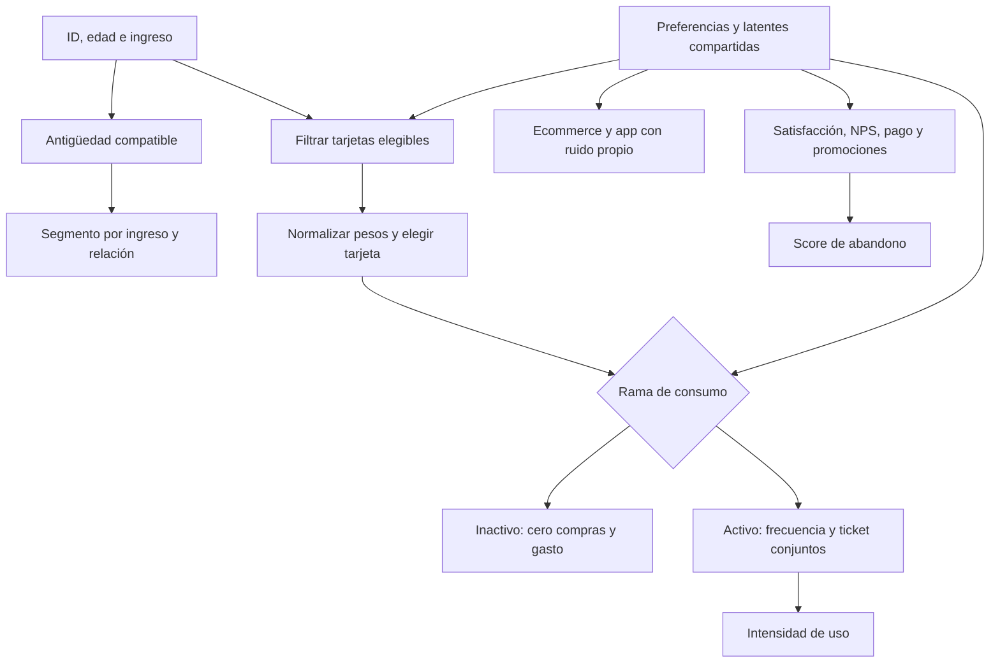

# Generador académico de clientes — primera versión

Genera perfiles relacionados mediante políticas explícitas y repara copias de registros existentes. Funciona sin internet con Python, NumPy y pandas, ya declarados en el proyecto. No usa entrenamiento, API, UI ni fuentes descargadas. **Las relaciones y los umbrales son supuestos de simulación; no representan hallazgos sobre clientes reales ni requisitos oficiales de Santander.**

Se revisaron la estructura, los notebooks, el Excel y sus glosarios. No se encontró `AGENTS.md` en el repositorio ni en sus directorios ascendientes. El resto del proyecto permanece intacto; todo el código nuevo está en `data`.

## Ejecutar

Desde la raíz del repositorio, con un Python >= 3.12 que tenga NumPy y pandas:

```bash
# Demostración sin referencia: todos los parámetros proceden del JSON DEMO.
python -m data.customer_generator generate --rows 10000 --seed 2026 \
  --config data/config.demo.json --output data/outputs/demo_sin_referencia

# Aprovechar directamente el Excel local y sus nombres originales.
python -m data.customer_generator generate --rows 10000 --seed 2026 \
  --reference dataset_dummy.xlsx --output data/outputs/demo_referencia

# Convertir la hoja dummy en una entrada CSV de referencia independiente.
mkdir -p data/outputs
python -m data.customer_generator extract-reference \
  --input dataset_dummy.xlsx --output data/outputs/referencia_dummy.csv
python -m data.customer_generator generate --rows 10000 --seed 2026 \
  --reference data/outputs/referencia_dummy.csv --output data/outputs/demo_referencia_csv

# Reparar el ejemplo deliberadamente incompleto e inconsistente.
python -m data.customer_generator repair \
  --input data/examples/clientes_inconsistentes.csv --seed 2026 \
  --output data/outputs/demo_reparacion

# Verificar idempotencia también después del intercambio por CSV.
python -m data.customer_generator repair \
  --input data/outputs/demo_reparacion/clientes.csv --seed 99 \
  --output data/outputs/demo_segunda_reparacion

python -m pytest data/tests -q
# Alternativa de biblioteca estándar cuando pytest no está en el entorno:
python -m unittest discover -s data/tests -v
```

Las carpetas de salida y el CSV de extracción deben ser **nuevos**. Para repetir un comando, elige otro nombre de salida. No se sobrescriben insumos ni resultados previos. `--reference` es una fuente para estimar distribuciones; `--input` es el archivo que se desea reparar. La CLI rechaza usar la misma ruta para ambos. La reparación nunca convierte implícitamente su entrada en referencia.

No hace falta instalar el resto del proyecto ni resolver todas las dependencias de su `pyproject.toml` para usar esta herramienta. La instalación de dependencias se realiza por separado en el entorno elegido; la ejecución de estos comandos no accede a la red. El lector acotado del XLSX usa sólo la biblioteca estándar, lee valores almacenados y rechaza fórmulas. Para otras hojas o formatos se recomienda exportar un CSV.

En esta máquina, el Python predeterminado no tenía pandas. Para ejecutar con las bibliotecas locales que se reutilizaron sin descargas, puede prepararse la sesión así, desde la raíz:

```bash
export PYTHONPATH="$(python -c 'import json; v=json.load(open("data/examples/verificacion.json")); print(v["local_pythonpath"]+":"+v["local_pytest_pythonpath"])')"
export PYTEST_DISABLE_PLUGIN_AUTOLOAD=1
```

Estas rutas son específicas de la máquina y no forman parte del generador. Se validó con Python 3.15.0, NumPy 2.5.4, pandas 3.1.1 y pytest 9.1.1. El entorno declarado por el proyecto, que pide pandas <3, no se modificó ni se ejecutó en esta sesión; sus versiones exactas no se validaron.

## Archivos y contrato

- `customer_generator/config.py`: esquema, carga JSON y validación de configuración.
- `customer_generator/policies.py`: funciones pequeñas de elegibilidad, probabilidades, consumo, perfil y validación.
- `customer_generator/generator.py`: `CustomerGenerator`, reparación, auditoría y exportación.
- `customer_generator/reference.py`: referencia empírica, lector local del Excel y contrato futuro para ingresos individuales ponderados.
- `customer_generator/cli.py` y `__main__.py`: CLI.
- `config.demo.json`: catálogo, parámetros, dependencias y registro de políticas con ID, descripción, variables, tipo y procedencia.
- `examples/clientes_inconsistentes.csv`: seis filas con faltantes, duplicados, cronología imposible, inelegibilidad y valores fuera de dominio; incluye combinaciones inusuales válidas que se conservan.
- `examples/reparacion_demostrada/`: los seis artefactos de una reparación ejecutada, incluidos 45 cambios auditados.
- `reference/procedencia_dummy.json`: huella SHA-256 del Excel, definiciones verificadas, discrepancias del glosario, frecuencias y resúmenes empíricos de sus 10,000 filas.
- `tests/test_generator.py`: pruebas de invariantes y de integración sin acceso a internet.

Cada ejecución exporta:

| Archivo | Contenido |
| --- | --- |
| `borradores.csv` | Borrador previo a completar/reparar. En reparación conserva las columnas originales, incluidas las extra. |
| `clientes.csv` | Exactamente las 16 columnas finales en el orden requerido. |
| `auditoria.csv` | Clave de fila, ID e índice originales, campo, valor anterior, nuevo, ID de política, acción `completar`/`corregir` y motivo. |
| `decisiones.csv` | Ramas probabilísticas, perfil compartido, opciones elegibles, probabilidades normalizadas y elecciones. `details` es JSON dentro de una celda CSV. |
| `auxiliares.csv` | Correspondencia de filas, latentes, preferencias y ticket medio; no se mezclan con el esquema final. |
| `reporte.json` | Semilla, RNG, índice de operación, versiones, configuración completa, hashes de código/insumos/salidas, procedencias, fuentes efectivas, faltantes, infracciones antes/después, modificaciones y estadísticas por tarjeta. |

`row-00000000` identifica la primera fila por **posición**, independientemente del índice pandas o del ID original. Esto permite auditar duplicados sin perder la identidad de las filas. El índice original se conserva en auditoría/auxiliares. El primer ID válido duplicado se conserva; los siguientes se sustituyen por IDs nuevos, reservando también los IDs válidos de filas posteriores. Los faltantes de esquema se añaden en la copia de trabajo, sin alterar el borrador recibido. Se normalizan los tipos numéricos de salida, conservando el valor de entradas numéricas válidas, incluso textos numéricos.

```text
customer_id, edad, segmento, antiguedad_meses, ingreso_mensual,
tarjeta_santander, uso_tarjeta_pct, transacciones_mes, gasto_mensual,
ecommerce_pct, pagos_puntuales_pct, app_logins_mes, nps, satisfaccion,
abandono_riesgo, activacion_promos_pct
```

## Árbol y convenciones

El borrador nuevo contiene ID, edad e ingreso; los demás campos están vacíos. La ejecución sigue el orden de dependencias y conserva ese borrador. No genera todas las variables de forma independiente para limitarse a comprobar sus rangos.



Los conteos representan **un mes sintético concreto** y son enteros. Es una convención de esta versión: el glosario describe compras y gasto promedio mensual. Ambos se refieren a las mismas compras y periodo; cero compras implica cero gasto. También se define ecommerce e intensidad como cero en ese caso; sí puede haber accesos a la app. Los porcentajes usan 0–100, satisfacción 1–5 con decimales, NPS individual entero 0–10 y riesgo 0–1.

La antigüedad corresponde a la **relación bancaria**, no a la tarjeta. Su cota conservadora es `(edad_en_años_completos - edad_inicio_relacion) * 12`, además del máximo de dominio. La edad mínima inicial de 18 años y las cotas de demostración son configurables. No se infiere una fecha exacta de nacimiento ni de contratación.

El Excel no define con precisión el numerador ni el denominador de `uso_tarjeta_pct`. Se adopta una **intensidad sintética**, condicionada por frecuencia y actividad con ruido. Nunca se divide gasto entre límite de crédito. El score de abandono usa entradas de experiencia y pago más ruido logístico; carece de calibración contra abandonos observados.

Se generan latentes comunes de afinidad digital, actividad, experiencia y comportamiento de pago, además de preferencias de cashback, simplicidad, viajes y hoteles. En reparación, los indicadores válidos disponibles anclan las latentes que sea necesario crear. La edad no determina la digitalización; ecommerce y app comparten afinidad con variación propia y una rama de cero accesos. Satisfacción y recomendación comparten experiencia, permitiendo desacuerdos. La puntualidad no depende del ingreso. Promociones combina afinidad digital y preferencia por beneficios.

Consumo combina actividad, ingreso y factores por producto para generar frecuencia y ticket medio. No impone gasto menor que ingreso: compras, deuda y pagos son magnitudes diferentes. Los límites técnicos de dominio se aplican por saturación explícita, sin ciclos de rechazo; no son máximos oficiales de consumo.

## Catálogo, elegibilidad y referencia

Los registros del Excel usan `LikeU`, `Free`, `Aeromexico Blanca`, `Aeromexico Platinum`, `Santander Gold`, `Santander Platinum`, `World Elite`, `Fiesta Rewards Oro` y `Fiesta Rewards Platinum`. El glosario usa `linea aerea Blanca/Platinum` para dos de ellos. Se eligió el nombre efectivo de las filas del caso, sin renombrar ni sustituir productos por ofertas comerciales actuales. Los segmentos son Mass, Select y Premier.

La elegibilidad filtra por mínimos inclusivos de edad/ingreso **antes** de normalizar preferencias. El ingreso alto conserva probabilidad positiva de tarjetas básicas. No hay prohibiciones por segmento. Los mínimos de ingreso del JSON, de 0 a 100,000 MXN según el producto, son **inventados exclusivamente como parámetros DEMO**. Aplicarlos al ingreso actual aproxima simplificadamente requisitos al contratar; no se dispone del ingreso histórico. Si una tarjeta es inelegible se cambia la tarjeta y se mantiene el ingreso válido.

El segmento es probabilístico según nivel de ingreso y antigüedad; no es una copia de la tarjeta. Los pesos base de tarjetas/segmentos proceden de las frecuencias de referencia cuando hay categorías reconocidas; en otro caso se usan los pesos explícitos del JSON. La afinidad multiplica el peso base. No se añaden pseudoconteos: una categoría con frecuencia cero conserva peso cero. Una referencia con sólo productos premium puede ser incompatible con clientes de ingreso cero y se rechaza explicativamente; hay que proporcionar una referencia compatible o generar sin ella.

Con referencia se extraen soportes empíricos completos de todas las variables numéricas válidas, con repeticiones, ceros y extremos, y las frecuencias categóricas. Se remuestrean directamente edad, ingreso y antigüedad; esta última se acota por cronología. No se aproxima la referencia por una normal ni por sus mínimos y máximos. Las marginales de campos dependientes se resumen en el reporte, pero sus valores nuevos se generan mediante políticas condicionales DEMO. No se promete preservar exactamente esas marginales ni el cruce tarjeta–segmento de la dummy. Los valores fuera de dominio se excluyen del soporte y se cuentan; cuando falta soporte válido se usa la configuración y se informa la fuente efectiva.

Sin referencia, edad usa una mezcla de intervalos, ingreso una mezcla lognormal con masa explícita en cero, y antigüedad una beta acotada. Los parámetros están íntegramente en JSON. En ambos modos, los coeficientes de relaciones, latentes, ruido, afinidades, actividad y riesgo siguen siendo de demostración. `reference/procedencia_dummy.json` identifica exactamente lo que sí fue observado en el repositorio. Las hipótesis del notebook EDA2 no se interpretan como restricciones oficiales.

## Reparación y extensión

Reparar conserva los valores válidos, incluso Free con ingreso alto, compras mayores que ingreso o desacuerdos entre NPS y satisfacción. No introduce necesariamente relaciones nuevas en datos válidos. Los candidatos provisionales se procesan con este mismo criterio conservador:

```python
from data.customer_generator import CustomerGenerator

generator = CustomerGenerator(seed=2026)  # un RNG local, sin tocar np.random global
result = generator.generate(10000)
repaired = CustomerGenerator(seed=2026).repair(mi_dataframe)
candidates = CustomerGenerator(seed=2026).generate(len(mi_dataframe), candidates=mi_dataframe)
```

Si cambia edad se vuelve a comprobar antigüedad y elegibilidad; si cambia ingreso se comprueba la tarjeta. Las elecciones estocásticas ya válidas, como segmento, frecuencia, promociones o ecommerce, se conservan aunque una entrada haya cambiado: no son identidades matemáticas con su predictor. Se reparan sólo si quedan inválidas, faltan o incumplen una restricción obligatoria.

Los derivados declarados en `stale_dependencies` se recalculan cuando cambia una entrada: gasto e intensidad tras cambiar compras, y score de abandono tras cambiar satisfacción/NPS/puntualidad. Si existía un ticket implícito válido `gasto/compras` con compras positivas, se conserva al regenerar gasto; en otro caso se obtiene uno condicionado al perfil. Completar una entrada también puede dejar obsoleto un derivado existente. No se conservan residuos aleatorios originales para recalcular el score: se crea uno nuevo sólo cuando hace falta. Una segunda reparación de una salida válida conserva todos sus valores y produce cero modificaciones, incluso con otra semilla.

`CustomerGenerator` copia la configuración y la entrada. Mantiene un único `numpy.random.Generator` por instancia. Dos instancias nuevas con misma semilla, código, versiones, configuración, insumos y orden producen los mismos datos, borradores, decisiones y auditoría. Llamadas consecutivas a la misma instancia avanzan su estado y el índice de operación. No se garantiza identidad binaria entre versiones distintas de NumPy/pandas/Python.

Para cambiar una política existente, edita sus parámetros y procedencia en JSON y sube `version`. No uses `eval`. Para añadir una política, implementa una función pequeña en `policies.py`, incorpórala al orden explícito en `generator.py` y a `POLICY_IDS`/validación de `config.py`, declara dependencias y prueba sus invariantes. El grafo documenta la ejecución; se rechazan ciclos, orden incompatible y la eliminación de dependencias necesarias. No es un lenguaje para ejecutar funciones arbitrarias desde configuración. Sólo los campos derivados soportados admiten invalidación automática; para agregar otro, modifica también el contrato de invalidación y sus pruebas.

La validación previa rechaza dominios incompatibles, probabilidades fuera de 0–1, pesos vacíos/negativos/no finitos/todos cero, umbrales invertidos, catálogos duplicados, ramas sin peso y falta de cobertura de elegibilidad en el extremo inferior del dominio admitido. Los filtros se vuelven a comprobar por fila. No se interpreta todos cero como uniforme y no hay ciclos de corrección o de rechazo indefinidos.

## Integración externa futura

No se descargó INEGI. El punto inicial es un CSV independiente más metadatos explícitos. `sample_weighted_individual_income` establece el contrato `persona_id`, `ingreso_mensual_individual`, `factor_expansion`; valida observación única por persona, unidad `persona`, periodo `mensual`, concepto de ingreso y fuente, y muestrea con el mismo RNG recibido. Es un adaptador reservado, todavía **no** una integración ENIGH automática ni una opción escondida de la CLI.

Para ENIGH habrá que construir explícitamente ingresos individuales, homologar periodicidad y concepto, y respetar los factores de expansión y el universo de personas; no sustituirlos por ingresos de hogar. Para ENIF se incorporarán perfiles financieros mediante un adaptador separado con año, universo, definiciones, ponderadores y reglas de unión compatibles; no se usarán como si fueran la misma distribución de ingresos. Antes de activar esas fuentes se deberá documentar su metodología y comprobar pesos/unidades. No se requieren para ejecutar esta primera versión.

## Verificación realizada

Las pruebas cubren fronteras de todos los productos, probabilidad de tarjetas básicas con ingreso alto, normalización posterior al filtro, configuraciones imposibles, conservación, idempotencia, reserva de IDs, auditoría de duplicados, revalidación tras cambiar antecedentes, entradas nullable, referencia empírica, pesos individuales, reproducibilidad, exportación sin sobrescritura y una generación completa de 10,000 filas. No exigen una correlación exacta ni interpretan cambios de correlación como realismo.

Los resultados concretos y el entorno local usado para esta entrega están en `examples/verificacion.json`. Las salidas voluminosas están en `data/outputs`, excluido del control de versiones por el `.gitignore` existente. La ausencia de infracciones demuestra coherencia con estas reglas declaradas; no valida representatividad poblacional.

La ejecución final pasó **30 pruebas y 22 subpruebas**. Tanto `outputs/entrega/sin_referencia` como `outputs/demo_referencia_csv` tienen **10,000 filas y cero infracciones obligatorias**. El ejemplo de seis registros requirió 45 modificaciones; la segunda reparación con otra semilla requirió cero. También se comprobó la idempotencia exacta después de leer los CSV exportados, la elegibilidad de todas las filas, cronología, dominios, hashes y conservación de los valores válidos deliberadamente inusuales del ejemplo.
